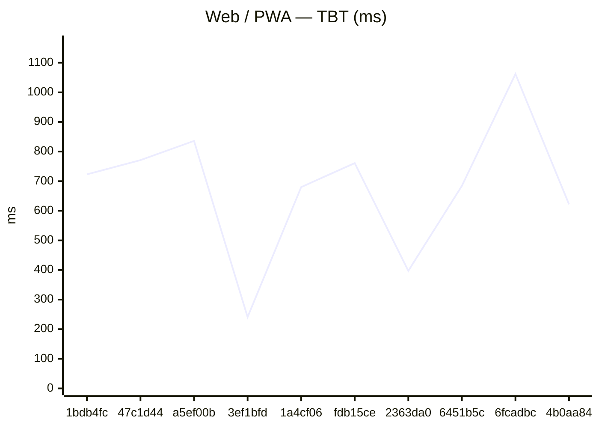
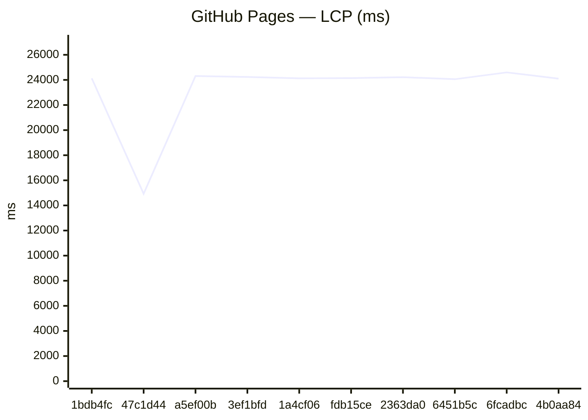
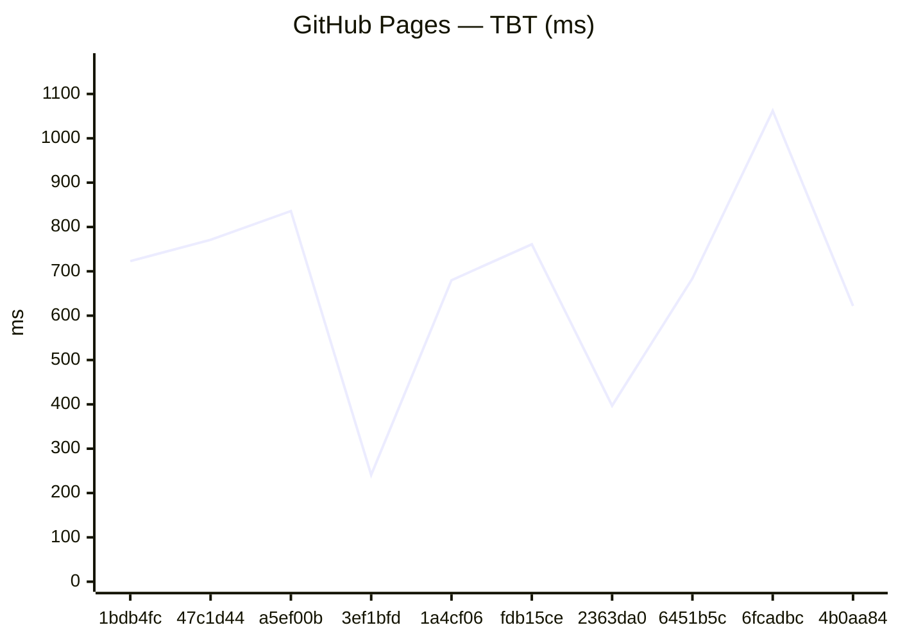
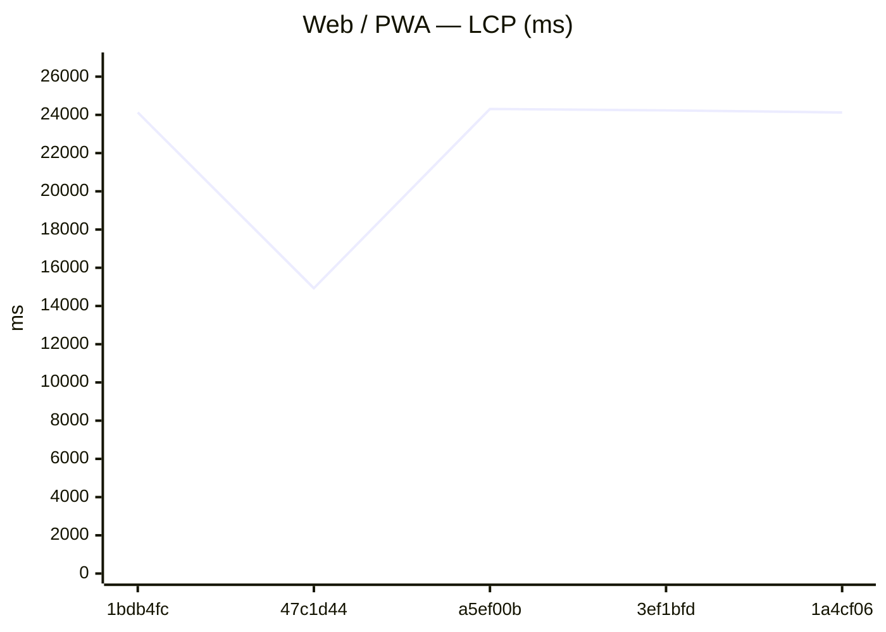
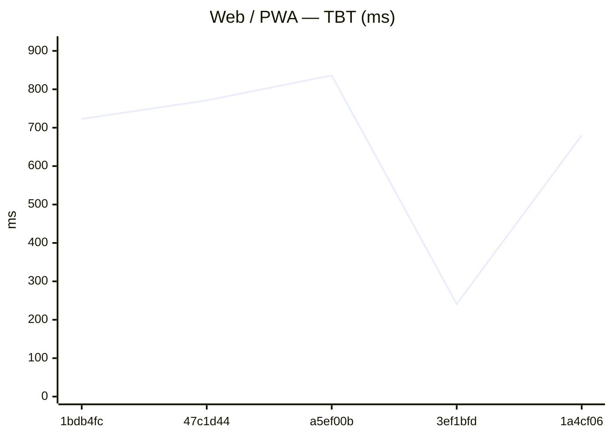
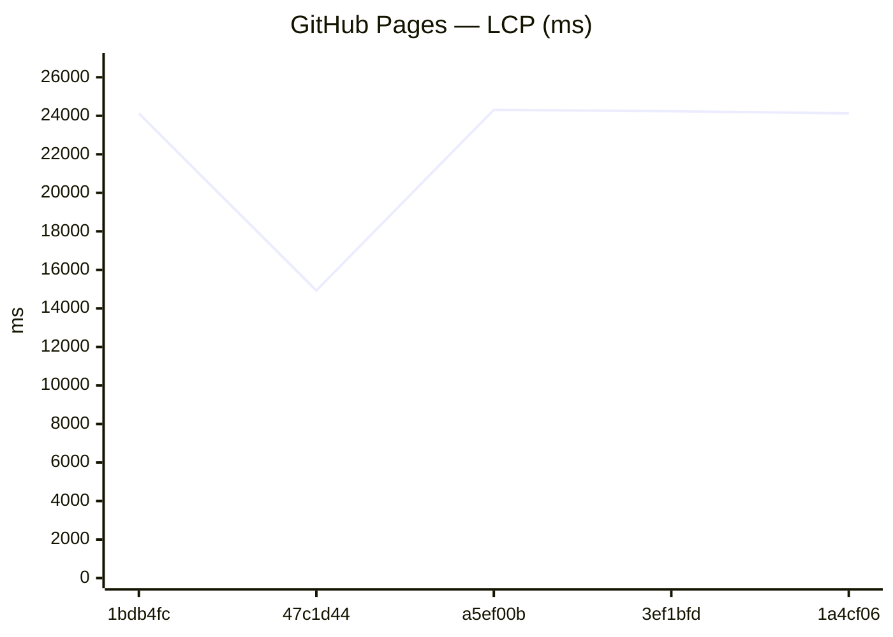
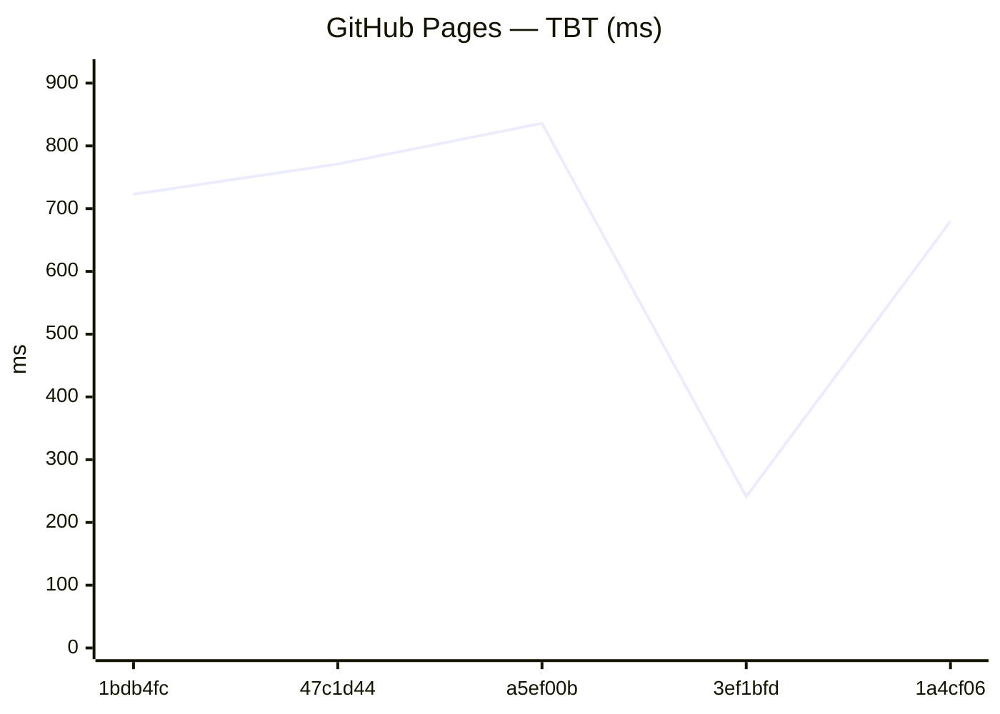
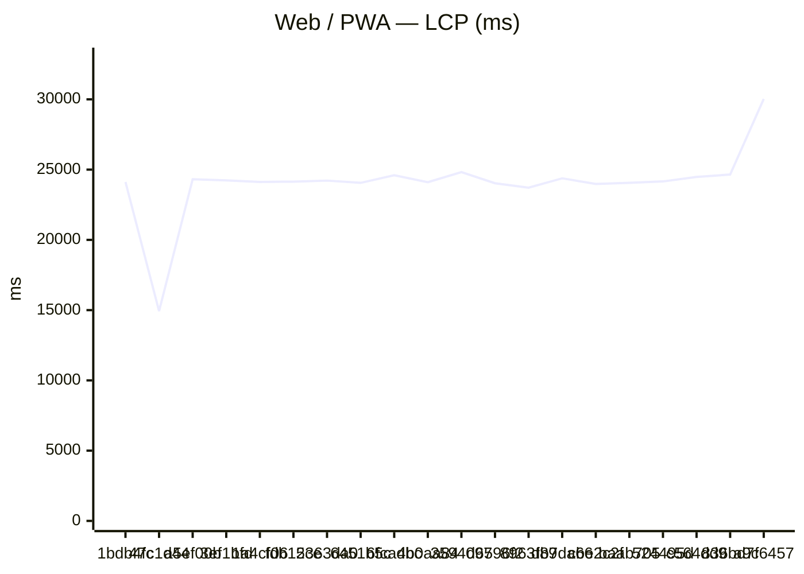
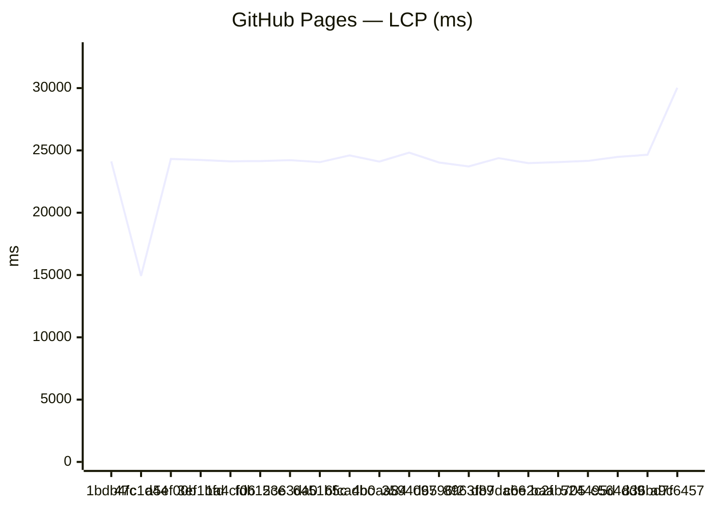
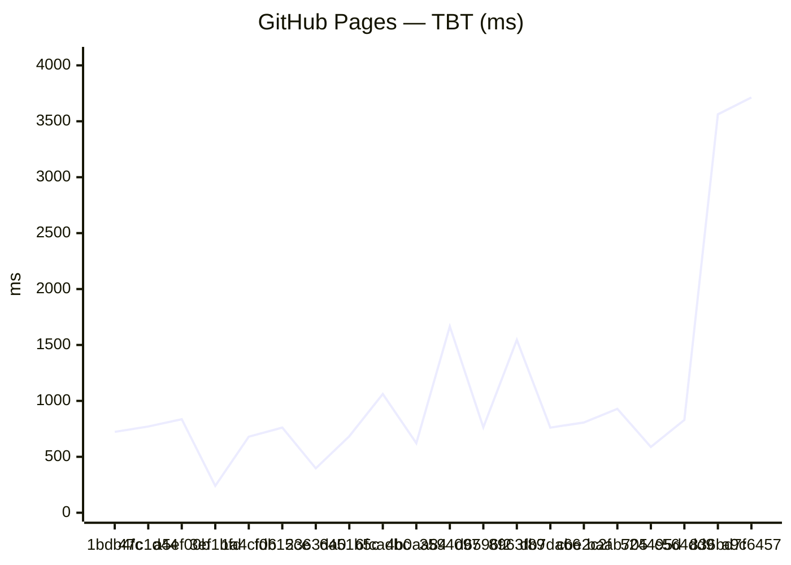

# Benchmark comparison (history)

Generated at **2026-10-25T15:15:38.238Z**.

To change the default number of runs in the primary sections below, edit **[compare.config.json](./compare.config.json)** (`window`). GitHub does not support interactive dropdowns in Markdown; optional **collapsed sections** list alternate window sizes.

---

### Web / PWA

| date | sha | status | LCP_ms | FCP_ms | TBT_ms | run |
| --- | --- | --- | --- | --- | --- | --- |
| 2026-10-25 15:15:13 | 1bdb4fc | ok | 24126 | 11886 | 723 | 40205875082 |
| 2026-10-13 15:22:56 | 47c1d44 | ok | 14929 | 7962 | 771 | 38421246977 |
| 2026-10-13 09:52:12 | a5ef00b | ok | 24310 | 11150 | 836 | 38379104979 |
| 2026-10-12 21:32:18 | 3ef1bfd | ok | 24236 | 11152 | 241 | 38310568817 |
| 2026-10-12 21:16:42 | 1a4cf06 | ok | 24125 | 11888 | 680 | 38307871974 |
| 2026-10-12 15:33:56 | fdb15ce | ok | 24144 | 11929 | 761 | 38270465446 |
| 2026-10-12 14:54:45 | 2363da0 | ok | 24218 | 10962 | 397 | 38266083659 |
| 2026-10-12 14:08:29 | 6451b5c | ok | 24056 | 11897 | 684 | 38260380591 |
| 2026-10-02 22:00:25 | 6fcadbc | ok | 24599 | 12119 | 1062 | 37069869865 |
| 2026-10-02 21:51:07 | 4b0aa84 | ok | 24101 | 11750 | 622 | 37069063744 |

### GitHub Pages

| date | sha | status | LCP_ms | FCP_ms | TBT_ms | run |
| --- | --- | --- | --- | --- | --- | --- |
| 2026-10-25 15:15:13 | 1bdb4fc | ok | 24126 | 11886 | 723 | 40205875082 |
| 2026-10-13 15:22:56 | 47c1d44 | ok | 14929 | 7962 | 771 | 38421246977 |
| 2026-10-13 09:52:12 | a5ef00b | ok | 24310 | 11150 | 836 | 38379104979 |
| 2026-10-12 21:32:18 | 3ef1bfd | ok | 24236 | 11152 | 241 | 38310568817 |
| 2026-10-12 21:16:42 | 1a4cf06 | ok | 24125 | 11888 | 680 | 38307871974 |
| 2026-10-12 15:33:56 | fdb15ce | ok | 24144 | 11929 | 761 | 38270465446 |
| 2026-10-12 14:54:45 | 2363da0 | ok | 24218 | 10962 | 397 | 38266083659 |
| 2026-10-12 14:08:29 | 6451b5c | ok | 24056 | 11897 | 684 | 38260380591 |
| 2026-10-02 22:00:25 | 6fcadbc | ok | 24599 | 12119 | 1062 | 37069869865 |
| 2026-10-02 21:51:07 | 4b0aa84 | ok | 24101 | 11750 | 622 | 37069063744 |

Last <strong>5</strong> runs (all platforms)

### Web / PWA

| date | sha | status | LCP_ms | FCP_ms | TBT_ms | run |
| --- | --- | --- | --- | --- | --- | --- |
| 2026-10-25 15:15:13 | 1bdb4fc | ok | 24126 | 11886 | 723 | 40205875082 |
| 2026-10-13 15:22:56 | 47c1d44 | ok | 14929 | 7962 | 771 | 38421246977 |
| 2026-10-13 09:52:12 | a5ef00b | ok | 24310 | 11150 | 836 | 38379104979 |
| 2026-10-12 21:32:18 | 3ef1bfd | ok | 24236 | 11152 | 241 | 38310568817 |
| 2026-10-12 21:16:42 | 1a4cf06 | ok | 24125 | 11888 | 680 | 38307871974 |

### GitHub Pages

| date | sha | status | LCP_ms | FCP_ms | TBT_ms | run |
| --- | --- | --- | --- | --- | --- | --- |
| 2026-10-25 15:15:13 | 1bdb4fc | ok | 24126 | 11886 | 723 | 40205875082 |
| 2026-10-13 15:22:56 | 47c1d44 | ok | 14929 | 7962 | 771 | 38421246977 |
| 2026-10-13 09:52:12 | a5ef00b | ok | 24310 | 11150 | 836 | 38379104979 |
| 2026-10-12 21:32:18 | 3ef1bfd | ok | 24236 | 11152 | 241 | 38310568817 |
| 2026-10-12 21:16:42 | 1a4cf06 | ok | 24125 | 11888 | 680 | 38307871974 |

Last <strong>20</strong> runs (all platforms)

### Web / PWA

| date | sha | status | LCP_ms | FCP_ms | TBT_ms | run |
| --- | --- | --- | --- | --- | --- | --- |
| 2026-10-25 15:15:13 | 1bdb4fc | ok | 24126 | 11886 | 723 | 40205875082 |
| 2026-10-13 15:22:56 | 47c1d44 | ok | 14929 | 7962 | 771 | 38421246977 |
| 2026-10-13 09:52:12 | a5ef00b | ok | 24310 | 11150 | 836 | 38379104979 |
| 2026-10-12 21:32:18 | 3ef1bfd | ok | 24236 | 11152 | 241 | 38310568817 |
| 2026-10-12 21:16:42 | 1a4cf06 | ok | 24125 | 11888 | 680 | 38307871974 |
| 2026-10-12 15:33:56 | fdb15ce | ok | 24144 | 11929 | 761 | 38270465446 |
| 2026-10-12 14:54:45 | 2363da0 | ok | 24218 | 10962 | 397 | 38266083659 |
| 2026-10-12 14:08:29 | 6451b5c | ok | 24056 | 11897 | 684 | 38260380591 |
| 2026-10-02 22:00:25 | 6fcadbc | ok | 24599 | 12119 | 1062 | 37069869865 |
| 2026-10-02 21:51:07 | 4b0aa84 | ok | 24101 | 11750 | 622 | 37069063744 |
| 2026-10-02 21:42:52 | 3594097 | ok | 24820 | 11355 | 1666 | 37068260917 |
| 2026-10-02 17:22:29 | d6596f2 | ok | 24030 | 11830 | 764 | 37040058330 |
| 2026-10-02 17:00:22 | 8963f89 | ok | 23715 | 7810 | 1546 | 37037557043 |
| 2026-10-02 16:26:38 | db7da66 | ok | 24380 | 7660 | 761 | 37033666746 |
| 2026-10-02 15:54:10 | cbe2c2f | ok | 23980 | 11054 | 807 | 37029973221 |
| 2026-10-02 14:57:34 | baab705 | ok | 24058 | 11830 | 929 | 37023306234 |
| 2026-10-02 14:49:05 | 524495d | ok | 24158 | 11805 | 588 | 37022309262 |
| 2026-10-02 14:38:47 | c564dd9 | ok | 24475 | 12025 | 830 | 37021074795 |
| 2026-10-02 14:04:13 | 836bd7f | ok | 24652 | 7960 | 3562 | 37017010488 |
| 2026-09-26 15:35:34 | a9c6457 | ok | 30029 | 11806 | 3713 | 36252356145 |

### GitHub Pages

| date | sha | status | LCP_ms | FCP_ms | TBT_ms | run |
| --- | --- | --- | --- | --- | --- | --- |
| 2026-10-25 15:15:13 | 1bdb4fc | ok | 24126 | 11886 | 723 | 40205875082 |
| 2026-10-13 15:22:56 | 47c1d44 | ok | 14929 | 7962 | 771 | 38421246977 |
| 2026-10-13 09:52:12 | a5ef00b | ok | 24310 | 11150 | 836 | 38379104979 |
| 2026-10-12 21:32:18 | 3ef1bfd | ok | 24236 | 11152 | 241 | 38310568817 |
| 2026-10-12 21:16:42 | 1a4cf06 | ok | 24125 | 11888 | 680 | 38307871974 |
| 2026-10-12 15:33:56 | fdb15ce | ok | 24144 | 11929 | 761 | 38270465446 |
| 2026-10-12 14:54:45 | 2363da0 | ok | 24218 | 10962 | 397 | 38266083659 |
| 2026-10-12 14:08:29 | 6451b5c | ok | 24056 | 11897 | 684 | 38260380591 |
| 2026-10-02 22:00:25 | 6fcadbc | ok | 24599 | 12119 | 1062 | 37069869865 |
| 2026-10-02 21:51:07 | 4b0aa84 | ok | 24101 | 11750 | 622 | 37069063744 |
| 2026-10-02 21:42:52 | 3594097 | ok | 24820 | 11355 | 1666 | 37068260917 |
| 2026-10-02 17:22:29 | d6596f2 | ok | 24030 | 11830 | 764 | 37040058330 |
| 2026-10-02 17:00:22 | 8963f89 | ok | 23715 | 7810 | 1546 | 37037557043 |
| 2026-10-02 16:26:38 | db7da66 | ok | 24380 | 7660 | 761 | 37033666746 |
| 2026-10-02 15:54:10 | cbe2c2f | ok | 23980 | 11054 | 807 | 37029973221 |
| 2026-10-02 14:57:34 | baab705 | ok | 24058 | 11830 | 929 | 37023306234 |
| 2026-10-02 14:49:05 | 524495d | ok | 24158 | 11805 | 588 | 37022309262 |
| 2026-10-02 14:38:47 | c564dd9 | ok | 24475 | 12025 | 830 | 37021074795 |
| 2026-10-02 14:04:13 | 836bd7f | ok | 24652 | 7960 | 3562 | 37017010488 |
| 2026-09-26 15:35:34 | a9c6457 | ok | 30029 | 11806 | 3713 | 36252356145 |

